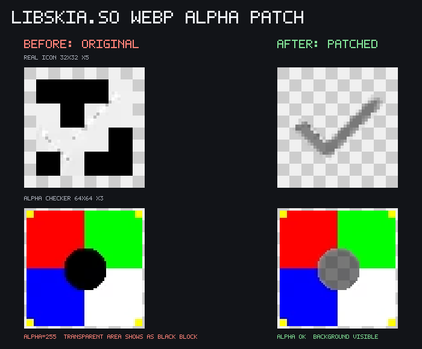

# 给系统打补丁：libskia.so 的 1 字节修复

> 前置阅读：[`07-system-webp-alpha.md`](07-system-webp-alpha.md)（确认系统缺陷的像素级证据）
> 状态：**补丁已通过三层验证；2026-11-15 14:39 已把 1 字节写入 system 裸块设备并独立校验正确，仍未重启（运行的进程还用旧库）**。本文记录靶点、补丁与验证方法；写入通道的实测对比、执行记录与操作步骤见 [`09-flash-decision.md`](09-flash-decision.md)。

## 1. 结论

之前写「不给系统打补丁」是在「靶子不明、要改 ARM native 大段代码」的前提下。2026-11-15 直接反汇编电视上拉回的 `libskia.so` 后，结论翻案：

- 缺陷精确定位到 **1 条指令**；
- 补丁只需要改 **1 个字节**；
- 这台机器是 `test-keys` / `userdebug`，`otacerts.zip` 的公钥与 AOSP 公开 testkey 匹配；但后续实测发现底层 recovery 是 MStar 私有镜像，**OTA 并不是合适的写入通道**（见第 5 节与 `09`）。

所以「能不能打补丁」的答案是 **能**，而且最省事的写入方式不需要 OTA、不需要 root：uid1000 直接对 system 的裸块设备写 1 字节。**该写入已于 2026-11-15 14:39 执行并校验正确，待重启生效**（见 `09` 第 5 节）。

## 2. 逆向靶点（以实际二进制为准，不用 AOSP 源码猜）

`/system/lib/libskia.so`（2,247,420 B）是 **ELF32 ARM / ARM 指令模式 / 未 stripped**，`.text` 的虚拟地址与文件偏移相同，反汇编条件很好。

- `DT_NEEDED` 里**没有** `libwebp.so`；dynsym 里定义了 303 个 WebP/VP8 符号 → **Skia 静态链接了整套完整版 libwebp**。改 `/system/lib/libwebp.so`、`libwebpimage.so` 都打不中靶子。
- `SkWEBPImageDecoder::setDecodeConfig`（`0x11394C`）末尾：

```
001139b4  bl   SkBitmap::setConfig
001139b8  mov  r0, r8
001139bc  mov  r1, #1          <-- 靶点
001139c0  bl   SkBitmap::setIsOpaque
```

**无条件 `setIsOpaque(true)`** —— 所有经 `BitmapFactory` 解出的 WebP 都被标成不透明。

- 解码器本身没问题：`onDecode` / `onDecodeRegion` 把 `WebPDecBuffer.colorspace` 设成 **MODE_RGBA(1)**、`is_external_memory=1`、stride 与 size 按 4 字节/像素计算；静态 libwebp 里有 `VP8DecompressAlphaRows`。**alpha 确实写进了像素，是 Skia 事后把它丢了**。这与 `docs/07` 的像素级实测完全吻合。

## 3. 补丁

| 项 | 值 |
|---|---|
| 文件偏移 | `0x1139BC`（VA 相同） |
| 原 | `01 10 a0 e3` = `mov r1, #1` |
| 新 | `00 10 a0 e3` = `mov r1, #0` |
| 语义 | `setIsOpaque(true)` → `setIsOpaque(false)` |
| 原库 sha256 | `4642931be450d0f16747d2930a13aea851249ff14815abfc571f446a05bb23d7` |
| 补丁库 sha256 | `f8e4328c5fea2aef49542013386fce76f57252156059ddcaeda2fe2718ecaef7` |
| diff | 恰好 1 字节 |

指令长度、控制流、栈、重定位都不变。影响面仅限 WebP 解码（该函数只被 `SkWEBPImageDecoder` 调用）；不带 alpha 的图视觉结果不变，只是少一个 opaque 绘制优化。

工具：[`../source/skia-patch/`](../source/skia-patch/)，`patch_libskia.py` 会校验原字节、只允许这一种输入，并复查输出只差 1 字节。

## 4. 硬约束

| 检查 | 结果 |
|---|---|
| `/system` 挂载 | ext4 `ro,nosuid` |
| `mount -o rw,remount /system`（uid1000） | Operation not permitted |
| `touch /system/...` | 失败 |
| uid1000 / uid2000 的 `CapEff` | 都是 0 |
| `/system` 剩余 | 15.1 MB |

普通 `cp` 到 `/system/lib` 走不通。

## 5. 写入通道：实测结论（详见 `09`）

最初评估时把「伪装为系统更新 / 签名 OTA」列为推荐，因为 `otacerts.zip` 是 AOSP testkey、模数与公开 `testkey.pk8` 匹配。2026-11-15 补做实测后**结论已修正**，完整证据见 [`09-flash-decision.md`](09-flash-decision.md)：

| 通道 | 实测结论 |
|---|---|
| A. 签名 OTA | **不推荐**。recovery 分区 `mmcblk0p6` 只有 8 MB，完整 dump 后非零率 99.6%，`ANDROID!` / `res/keys` / `META-INF` / `update-binary` / `edify` / ELF / ZIP 特征全部 0 命中 → MStar 私有镜像。`install-recovery.sh` 还要跑 `update_recovery_sign` 做私有签名；实际升级入口是 `com.stv.systemupgrade` / `LetvRemoteUpgradeService` 的私有包格式。testkey 只解决框架层 `verifyPackage()`，不等于底层会执行标准 Edify 脚本。 |
| B. 改内存 | **做不到**。zygote 是 root + 全 capabilities，各 app 是独立 `u0_aXX`，uid1000 无 `CAP_SYS_PTRACE`，`/proc/<pid>/mem` 全部 0600 且不同 uid；uid2000 连 `maps` 都是 Permission denied。就算能写也只产生单个 COW 私有页、重启即失效。`setprop wrap.*` 实测返回 0 但属性未落地，免刷机的 `wrap` + `LD_LIBRARY_PATH` 路线也不通。 |
| **C. 裸块 1 字节写（推荐）** | **全部前置条件已闭合**。`mmcblk0p9` 是 `system:system 0660`，uid1000 `test -w` = 0，`dd count=0` 打开写 = 0。 |

裸块路线的实测常量：

| 项 | 值 |
|---|---|
| `libskia.so` 在 `mmcblk0p9` 的物理起始 | **30,818,304** (`0x1D64000`，4K 对齐)，整文件 2,247,420 B 与备份逐字节相同 |
| **补丁点物理偏移** | **31,947,196** (`0x1E779BC`，= 起始 + `0x1139BC`) |
| 该处读回 8 字节 | `01 10 a0 e3 90 7a fd eb` ✓ |

定位用「前 64 MB 分区 dump 拉回本地 → Python 扫 `SkWEBPImageDecoder` 全部 5 个命中 → 与 so 内 5 个偏移取交集 → 4K 对齐 + ELF magic + 整文件逐字节相等三重确认」得到唯一解。**注意 `busybox grep` 不支持 `-b`，toolbox `grep -b` 给的是行偏移，都不能直接当物理偏移用**（旧版 `flash_via_block.sh` 模板里的做法有误，已修正为实测常量 + 多重校验）。

工具：`source/skia-patch/flash_via_block.sh`（`dry` / `apply` / `rollback` 三模式，默认 dry）+ `flash_on_tv.py`（PC 一键驱动，走 uid1000 通道）。**dry 实测通过，2026-11-15 14:39 已执行 `apply` 并独立校验；待手动重启。**

## 6. 如何验证「补丁改得对不对」（三层已实测通过）

`patch_libskia.py --verify` 只回答「生成的文件是否只差 1 字节」。这**不足以**证明改对了：字节可能落在错误的函数、喂给错误的调用、破坏 ELF 加载，或者虽然改了标志位但行为没修好。完整的验证分三层，另有刷入后的一层。

### 第 1 层：离线静态强校验 —— `source/skia-patch/verify_libskia.py`

对原库与补丁库做 **67 项检查，67 项通过**（报告 `patch-libskia/verify_static.log` / `.json`）：

| 类别 | 关键结论 |
|---|---|
| 字节 diff | 恰好 1 字节（`0x1139BC`：`01`→`00`），两库 sha256 与文档一致 |
| ELF 结构 | ELF32/LE/EM_ARM/ET_DYN；ELF header、PHDR 表、SHDR 表字节一致；除 `.text` 那 1 字节外，**全部 24 个 section 完全一致** |
| 地址映射 | 补丁在可执行 PT_LOAD（flags=5）内；`VA == off == 0x1139BC`；`.text addr == off`；`va2off` 往返一致（原报告「VA==文件偏移」的假设被证实，不是想当然） |
| 重定位 | 5438 条 REL 中**没有**任何一条覆盖该字 → linker 不会在加载时把补丁覆盖回去 |
| 符号归属 | dynsym 确认该字属于 `_ZN18SkWEBPImageDecoder15setDecodeConfigEP8SkBitmapii`（`0x11394C`, size=132） |
| 指令语义 | `0xE3A01001 ^ 0xE3A01000 = 1`，**只有立即数变化**，opcode/条件码/寄存器不变；条件码仍为 AL |
| 调用目标 | 紧随其后的 `bl 0x72408` 由 ELF dynsym 解析为 `_ZN8SkBitmap11setIsOpaqueEb`，补丁前后该 BL 完全相同（控制流不变） |
| 影响面 | 全库 22 处 `setIsOpaque` 调用：另有 6 处硬编码 `#1`，**全部在 BMP/JPEG/WBMP**（这些格式本就不含 alpha）；PNG 是动态参数。→ **WebP 是唯一「格式支持 alpha 却硬编码 opaque」的解码器**，正是异常点 |
| 可加载性 | `.hash/.dynsym/.dynstr/.rel.dyn/.rel.plt/.ARM.exidx/.ARM.extab/.gnu_debuglink/.dynamic/.got/.plt` 全未变；Android linker 不校验 build-id / debuglink CRC，哈希表只哈希符号名 → 无需重签名、无需重 dexopt |

### 第 2 层：不刷机、不重启的 A/B 动态验证 —— `source/skia-patch/probe/`

**原理**：普通 app 从 zygote fork，继承了已 mmap 的 `/system/lib/libskia.so`，`LD_LIBRARY_PATH` 对它无效。必须用 `app_process` 直接启动**非 zygote 进程**，linker 才会重新解析 `DT_NEEDED` 并优先查 `LD_LIBRARY_PATH`。把补丁库命名成 `libskia.so` 放在 `/data/local/tmp/skiapatch`，同一探针跑两次：

```sh
# A 对照组：系统原库
ANDROID_DATA=/data/local/tmp/skiadroid \
  CLASSPATH=/sdcard/Download/skiaprobe.dex \
  app_process /system/bin com.tv.skiaprobe.ProbeMain orig

# B 实验组：只多一个 LD_LIBRARY_PATH
LD_LIBRARY_PATH=/data/local/tmp/skiapatch:/vendor/lib:/system/lib:/system/lib/egl \
  ANDROID_DATA=/data/local/tmp/skiadroid \
  CLASSPATH=/sdcard/Download/skiaprobe.dex \
  app_process /system/bin com.tv.skiaprobe.ProbeMain patched
```

**踩过的坑**：`/data/dalvik-cache` 是 `system:system 0771`，uid2000 无法创建 dex 缓存 → dex 加载失败 → `app_process` 报 `could not find class` 后在 `0xdeadd00d` 故意 SIGSEGV（退出码 139）。用 `ANDROID_DATA` 把 dexopt 缓存指向可写目录即可解决。

探针会打印 `/proc/self/maps` 中 `libskia.so` 的真实路径（**证明这次到底加载了哪份库**），再解码 8 个样本，输出 `hasAlpha / alphaSum / opaque / semi / transparent / 像素 checksum`。实测 **12/12 检查通过**：

| 样本 | A 原库 | B 补丁库 |
|---|---|---|
| `LIBSKIA_MAPS` | `/system/lib/libskia.so` | `/data/local/tmp/skiapatch/libskia.so` |
| `02_vp8x_alph.webp`（真实小电视图标，32×32） | `hasAlpha=false`, opaque=1024, semi=0, transparent=0 | `hasAlpha=true`, opaque=0, **semi=244, transparent=780** |
| `11_checker_vp8x.webp`（合成棋盘，64×64） | `hasAlpha=false`, alphaSum=1044480, opaque=4096 | `hasAlpha=true`, **alphaSum=988981**, opaque=3659, semi=437 |
| `10_checker.png`（源 RGBA 参考） | alphaSum=988981, opaque=3659, semi=437 | 同左（PNG 不受影响） |
| 6 个不带 alpha 的样本 | checksum | **与 A 完全相同 → 零回归** |

最有力的一点：补丁后 VP8X 的 **alphaSum 与源 PNG 精确相等**（988981），而颜色 checksum 不同（VP8 有损压缩），说明补丁只恢复了 alpha、没有碰颜色解码。

**如实记录副作用**：`setIsOpaque(false)` 是无条件的，所以 B 组里**所有** WebP（包括无 alpha 的裸 VP8）`hasAlpha` 都变成 `true`。这不改变任何像素（checksum 全同），只是少走一条 opaque 绘制快速路径，属于可接受的性能代价。

### 第 3 层：与独立参考逐像素比对 —— `probe/compare_alpha.py`

为避免「只是翻转了标志位」的误判，把探针导出的 PNG 用 PC 端 ffmpeg 解成 raw RGBA，直接比对 **alpha 平面**：

| 比对 | 结果 |
|---|---|
| A 组 WebP alpha vs 源 PNG | 4096 像素中 **437 个不同**，maxdelta=127（半透明圆被抹平） |
| B 组 WebP alpha vs 源 PNG | 4096 像素 **0 差异** |
| B 组 WebP alpha vs PC ffmpeg/libwebp 参考 | 4096 像素 **0 差异** |
| B 组真实图标 alpha vs PC ffmpeg 参考 | 1024 像素 **0 差异** |
| 无 alpha 样本 R/G/B 三通道 A vs B | 全部 **0 差异** |

结论：**`ALPH` 通道被逐像素完整恢复，不只是标志位变化**。

### 第 4 层：刷入后（写入校验已完成，待重启）

前三层证明的是「补丁库本身正确」。真正写进 `/system` 之后还要单独确认写入与生效：

1. **已完成**：从块设备独立 dump 整个 so，sha256 = `f8e4328c…` 与补丁库完全相同、与原库只差 `0x1139BC` 一字节。注意重启前经 VFS 读 `/system/lib/libskia.so` 仍是原库哈希（page cache），属预期。
2. **待用户手动重启**（zygote 已 mmap 旧库，native 库不进 dalvik-cache，无需重 dexopt，但必须重启）。
3. 重启后查 `/proc/<zygote 或 system_server>/maps`，确认映射的是新的 `/system/lib/libskia.so`；重跑 `webpprobe` 或直接看图标。
4. 回归：PNG 海报、裸 VP8、芒果TV / 小电视 / 乐视桌面三类图标。
5. 按项目约定，**不主动测试任何遥控器按键**。

### 小结：改完到底会变成什么样



> 图由 `source/skia-patch/probe/make_effect_compare.py` 生成，素材是 A/B 探针导出的**真实解码像素**，不是示意图。灰白棋盘是合成进去的背景，用来显示透明；左列的黑块 = alpha 被丢弃。

| 会变好 | 不变 / 不受影响 |
|---|---|
| 带 `ALPH` 的 VP8X 小图标：透明背景正确透出，不再黑白块 | PNG / JPEG 海报大图：像素 0 差异 |
| 半透明像素（阴影、渐变、圆形遮罩）：恢复 128 等中间 alpha，不再被压成实心黑 | 无 alpha 的 VP8X（仅 ICCP）、裸 VP8：像素 0 差异 |
| 小电视、芒果TV 首页分类图标、乐视自带桌面图标**同时**恢复（三者都走 `BitmapFactory`） | 音量 / 背光 / 桌面 / 其它系统行为：完全不碰 |
| **一劳永逸**：以后新下发的图标也自动正确，不必再跑缓存降级脚本 | **已写入磁盘但尚未重启；当前打开电视仍是老样子** |

副作用只有一个：`setIsOpaque(false)` 是无条件的，所有 WebP 的 `hasAlpha()` 都会变成 `true`，少走一条 opaque 绘制快速路径（理论上绘制略慢），但像素结果完全不变。

补丁已写入磁盘（第 5 节裸块通道，**执行记录见 `09` 第 5 节**），但要全局生效还需**手动重启**让 zygote 重新 mmap；代价是刷机风险，收益是不用再维护缓存降级脚本。

## 7. 回退

- 原库完整备份在本地（`build/assets/implib/libskia.so`）；补丁只差 1 字节，回退执行 `python flash_on_tv.py --mode rollback --confirm-write-system`（把 `0x00` 写回 `0x01`）后重启即可。
- 刷入前**整盘 dd 备份 system 分区**（512 MB，`python flash_on_tv.py --mode backup`）；脚本另会强制备份补丁点所在 4K 块。
- 验证脚本与产物都在 `source/skia-patch/` 与 `build/patch-libskia/`，A/B 验证与 dry-run 全程**不写 `/system`、不重启、不按遥控器**；`apply` 已写入 1 字节（见 `09` 第 5 节），仍需手动重启。

## 8. 资料与工具位置

仓库内：

- `source/skia-patch/patch_libskia.py` —— 生成 / 基础校验 1 字节补丁
- `source/skia-patch/verify_libskia.py` —— 第 1 层：离线静态强校验（67 项）
- `source/skia-patch/probe/ProbeMain.java` + `build_probe.py` —— 第 2 层：电视端 A/B 探针
- `source/skia-patch/probe/verify_on_tv.py` —— 一键 push + 跑 A/B + 判定
- `source/skia-patch/probe/compare_alpha.py` —— 第 3 层：逐像素 alpha 比对
- `source/skia-patch/probe/make_effect_compare.py` —— 补丁前后效果对比图生成
- `source/skia-patch/flash_via_block.sh` —— 电视端刷入脚本（实测偏移、`dry`/`apply`/`rollback`，默认 dry）
- `source/skia-patch/flash_on_tv.py` —— PC 端一键驱动（push 样本、走 uid1000 通道、判定日志）
- `docs/09-flash-decision.md` —— OTA / 改内存 / 裸块三条通道的实测对比与刷入操作手册

调查用的完整取证报告与原始日志不在仓库内（含设备快照），在 `aerial-tools/build/`：

- `skia-patch-feasibility-2026-11-15.md`（完整报告）
- `skia_disasm_all.txt` / `skia_helpers.txt` / `skia_callers.txt`（反汇编）
- `survey_*.log`（权限、挂载、OTA 探查）
- `patch-libskia/libskia-patched.so`（补丁产物）
- `patch-libskia/verify_static.log` / `.json`、`verify_dynamic_run.log` / `.json`、`verify_alpha.log`（三层验证实测记录）
- `patch-libskia/probe_out/skiaprobe/*.png`（A/B 两组导出的解码结果）
